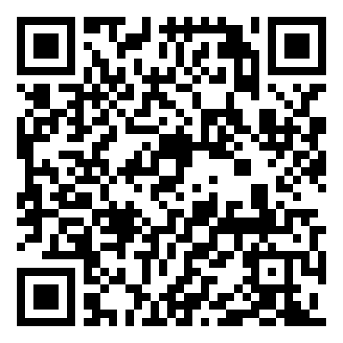

# Teleportación cuántica · Plenaria 4

**Ponentes:** Marcos A. Torres · Jhon Kevin Ruiz Cortes
**Curso:** Mecánica Cuántica 2026-II · Programa Académico de Física · Universidad Distrital Francisco José de Caldas · Prof. John Díaz

## Presentación interactiva
Abrir en línea (GitHub Pages): **https://marctorressa.github.io/teleportacion_cuantica_plenaria/** · o descargar `index.html` y abrirlo en Chrome/Edge (funciona sin internet).
Teclas: → / ← avanzar y retroceder, F pantalla completa, ? atajos.

## Contenido
| Carpeta | Qué hay |
|---|---|
| `index.html` | Presentación interactiva con simulaciones en vivo |
| `videos/` | Animación de la esfera de Bloch (12 s) y video de la simulación del laboratorio (61 s) |
| `codigo/` | Simulación con matrices densidad (`teleport_numpy.py`), demo en Qiskit (`teleport_qiskit.py`), animación de Bloch y generador del QR; figuras en `codigo/figuras/` |
| `bibliografia/` | Las 37 referencias, numeradas igual que en las diapositivas, con enlaces DOI |
| `articulos/` | Enlaces a los artículos de 2026 y al video de QuTech |

## Ejecutar las simulaciones
```bash
cd codigo
pip install -r requirements.txt
python teleport_numpy.py     # figuras y verificaciones
python teleport_qiskit.py    # circuito con correcciones clásicas y ruido
```


